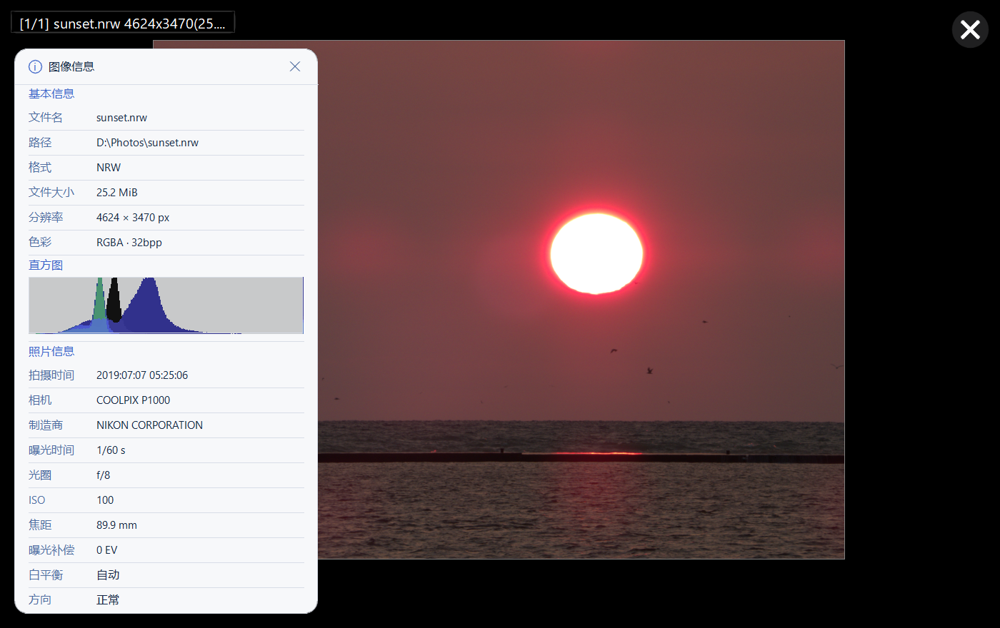

<p align="center">
  
</p>

<h1 align="center">YeImageViewer 看图</h1>

<p align="center">
  <a href="LICENSE"></a>
  
</p>

<p align="center">中文 | <a href="README_EN.md">English</a></p>

**YeImageViewer** 是一款简约、快速的原生 Windows 图片查看器，支持常见静态图、动图、RAW、iOS Live Photo 和 Android Motion Photo，并提供 EXIF 查看、打印、简单编辑和文件关联功能。

当前版本：**v1.38.1-rc2**（本地候选版，未公开发布；公开正式版仍为 v1.38.0） · [修改记录](CHANGELOG.md)

本项目基于 [JarkViewer](https://github.com/jark006/JarkViewer) 开发，并遵循 GNU GPL v3 许可证。感谢上游作者 JARK006 与所有贡献者。



> 图为沉浸显示模式与完整信息面板。示例照片取自 [raw.pixls.us](https://raw.pixls.us/)（CC0 公有领域），相机 Nikon COOLPIX P1000。

## 操作方式

1. 切换图片：底部工具栏，或按 `←` / `→`
2. 放大缩小：`Ctrl + 鼠标滚轮`，或按 `↑` / `↓`
3. 旋转图片：右下角工具条，或按 `Q` / `E`
4. 平移图片：普通滚轮上下移动，`Shift + 鼠标滚轮`左右移动，也可鼠标拖动或按 `W` / `A` / `S` / `D`
5. 图像信息：点击滚轮，或按 `Tab` / `I`
6. 全屏：双击窗口，或按 `F` / `F11`
7. 复制图像：`Ctrl + C`
8. 打印图像：右键菜单，或按 `Ctrl + P`
9. 设置：右下角工具条，或按 `F1`
10. 逐帧浏览：顶部控制栏，或按 `J` / `K` / `L`
11. 分解动图：`Ctrl + S`

设置窗口的“快捷键”页可以重新指定键盘快捷键和三种滚轮动作；修改会写入现有的 4096 字节配置文件并在下次启动继续使用。

菜单有两个固定入口：`Ctrl + 鼠标右键` 和 `Shift + F10`，不受“右键退出”设置影响，也不能改绑为其他动作；普通右键仍按用户设置打开菜单或退出。快捷键页会显示这两个入口，不增加工具栏按钮。

开启“记住最后使用显示器”后，再次启动优先使用上次退出时的显示器（包括无图片启动）；该屏断开、尚无记忆或关闭选项时，打开图片跟随鼠标所在屏，鼠标位置不可用时回退主屏。

打开图片时默认进入覆盖当前显示器工作区的无边框沉浸预览。逐像素 Alpha 黑色遮罩约为 60% 不透明度，桌面仍可透出，图片本身保持不透明，不再使用 Windows 毛玻璃；退回普通窗口后，图片外区域改用不透明的 `#7F7F7F` 中灰色，拉大窗口也保持稳定。小图按当前 DPI 下的 100% 逻辑尺寸显示；横图最多占工作区宽度的 90% 和高度的 82.5%，竖图只在宽度超过 90% 时缩小，超出高度的部分可上下拖动查看。
单击图片外背景或按 `Esc` 会退回带边框窗口，客户区按照退出沉浸时当前图片的约定显示尺寸确定，并受工作区 90% 上限约束；进入沉浸后浏览到其他图片再退出，会使用那张当前图片的尺寸。回到普通模式后继续切换上一张、下一张不会改变窗口外框，各图片仍沿用自己的沉浸预览百分比。旋转方向会按图片路径自动保存。
设置中的“记住最后使用的显示器”默认开启；如果该显示器已断开，窗口会回到主显示器。

## 观看规则与连续阅读

在“设置 → 常规”中，窗口形态、缩放规则和普通窗口尺寸分别选择。开启“锁定观看规则”后，切换不同分辨率的图片会重新按规则计算，关闭重开仍保留；临时放大、缩小和平移不会改变下一张的规则。明确选择“适应窗口”或“实际大小”命令则更新锁定规则。

- 长图默认可按原始 100% 从顶部开始，不缩成一整张，也不拉伸到窗口宽度；可改为整图适应窗口。此选项独立生效，优先于长图的普通尺寸/缩放规则。升级旧配置保留适应选项，不强制改变用户选择。
- “长图水平居中”使鼠标斜向拖动只上下移动，缩放后也不会左右晃动。拖拽加速可选 1×、2×、3×，只作用于图片或阅读画布。
- “放大小图”默认关闭；开启后适应窗口可以等比放大，实际大小始终为 100%。
- “循环浏览”关闭后到首尾停住；显示质量可选高质量抗锯齿、快速、像素清晰。
- 动图顶部显示当前帧/总帧及进度条，拖动定位自动暂停，J/L 逐帧，K 继续；可选择自动隐藏或常显。
- 连续阅读可从设置或右键菜单开启。纵向/横向均支持单页和左右双页，滚轮沿阅读轴连续滚动，Ctrl + 滚轮缩放。底部阅读条可以切换布局、方向、当前页置左/置右、上一组/下一组或退出。
- 配对调整作用于整个文件夹的奇偶配对，并保存到配置；首尾缺页显示空白，不改文件名或文件顺序。点击任一页将它设为当前文件，信息、复制和删除针对所选页。
- 信息面板在所有窗口形态下都能显示直方图和分辨率，底部按钮栏已移除；Tab/I 切换，C 复制信息（自定义改绑优先），复制结果走顶部统一提示。

未开启锁定时，普通照片保留既有沉浸预览布局；长图规则和连续阅读选项仍独立生效。本次连续阅读针对本软件支持的图片文件，不新增 PDF 渲染器。

## 格式支持

- 静态：`apng avif avifs blp bmp dds dib exr gif hdr heic heif ico icon jfif jp2 jpe jpeg jpg jxl jxr lep livp pbm pcx pfm pgm pic png pnm ppm psd psdt pxm qoi ras sr svg tga tif tiff webm webp wp2`
- 动态：`gif webp png apng jxl avif`
- 视频（只在直接打开时解码前若干帧当动图，不出现在同目录的翻页列表里）：`3gp avi evo flv m2ts m4v mkv mov mp4 mts mxf ts vob wmv`
- 实况：`livp`、`jpg/heic/heif` 中的 LivePhoto、MicroVideo 或 MotionPhoto，可播放随视频录下的声音（打开时的自动播放默认静音，鼠标移到「实况」标记上即出声）
- RAW：`3fr ari arw bay cap cr2 cr3 crw dcr dcs dng drf eip erf fff gpr iiq k25 kdc mdc mef mos mrw nef nrw orf pef ptx r3d raf raw rw2 rwl rwz sr2 srf srw x3f`

## 构建与本机安装

需要 Windows x64、Visual Studio 2026 Build Tools、MSVC v145 和项目所需静态库。

```powershell
.\buildRelease.ps1
.\installLocal.ps1
.\packageRelease.ps1 -SkipBuild
```

构建产物位于 `x64/Release`。

**本程序是绿色版，不需要安装**：`YeImageViewer.exe` 一个文件拷到哪双击就能用，普通看图不写注册表、不留后台服务。设置存在旁边的 `YeImageViewer.db` 中：前 4096 字节为兼容设置，后续文本保存外部编辑器、文件目标、旋转及阅读记录。没有就生成，有就直接用；删掉它恢复默认。换机器可复制 EXE 与 DB。`YeThumbnailProvider.dll` 为可选缩略图组件。

文件关联页的「立即关联」登记打开方式与默认应用能力，Windows 10/11 的受保护默认应用需用户在系统「默认应用」中确认，不覆盖其他程序的用户选择。更换程序路径后请重新登记。使用过关联时，删除程序前先选「全不选」并「立即关联」撤销格式登记；系统默认应用另行改回。使用过 `installLocal.ps1` 时还需移除其快捷方式和缩略图注册，不能只删除文件夹就认为这些系统登记也消失了。

候选版打包可用 `./packageRelease.ps1 -SkipBuild -NoArchive -OutputDirectory artifacts/candidates/v1.38.1-rc2`；不公开推送，验收后单独复制到两个归档根目录的「候选版」子目录。默认不加 `-NoArchive` 的正式打包仍自动双归档、核对哈希且拒绝覆盖历史产物。

设置 → 常规中的「拖拽惯性滑动」默认关闭。开启后，在图片上按住左键快速拖动并松手，图片会沿松手前方向继续滑动并减速停止；「惯性滑动灵敏度」1～9 档只控制松手后的时长和距离，默认 5。工具栏自动／固定倍率仍只控制按住拖动，不与惯性重复相乘。慢拖、停顿后松手、Shift 精细拖动不触发惯性；再次输入或到达边界立即停。

`installLocal.ps1` 是可选的便利脚本：装到 `%LOCALAPPDATA%\Programs\YeImageViewer`、注册当前用户的缩略图组件、建开始菜单和桌面快捷方式；它不会自动改变图片文件的默认打开程序。不跑它完全不影响使用。

`packageRelease.ps1` 产出三样，都受 25 MiB 下载体积门禁约束：

| 产物 | 体积 | 用途 |
| --- | --- | --- |
| `YeImageViewer.exe` | 约 27 MiB | 只想看图就下这一个 |
| `...-portable.zip` | 约 15 MiB | Windows 自带就能解压，含缩略图 DLL 和说明 |
| `...-portable.7z` | 约 8 MiB | 体积最小，需要 7-Zip |

不再提供一键安装程序：它是 7z SFX 做的，而 SFX 的版本信息写着 `7z Setup SFX small`，Windows 的「程序兼容性助手」据此判定它是安装程序，又因为它退出时不写卸载项，于是**每装一次就弹一次「可能未正确安装此程序」**。本程序本来就是绿色单文件，装不装都一样，没必要为此留一个会吓人的弹窗。

本仓库从 JarkViewer 浅克隆开始开发。若重新准备上游源码，建议保留 README 推荐的浅克隆方式：

```sh
git clone git@github.com:jark006/JarkViewer.git --depth=50
```

上游静态库可从 [JarkViewer static_lib](https://github.com/jark006/JarkViewer/releases/tag/static_lib) 获取，但其中的 `avif.lib` 与 `heif.lib` 不能直接用：
看图软件只解码不编码，本仓库已去掉 AV1（aom）与 HEVC（x265）编码器，主程序也不再链接 `x265-static.lib`，
直接拿上游的库会链接失败。先跑一次下面的脚本重建这两个库（约 4.9 MiB 的体积差就来自这里）：

```powershell
.\scripts\build-thirdparty-slim.ps1 -Install   # libavif / libheif，去掉编码器
.\scripts\build-opencv-slim.ps1 -Install       # opencv_world，去掉 IPP 与用不到的模块
```

上游实现资料可参考 [DeepWiki](https://deepwiki.com/jark006/JarkViewer) 和 [Zread](https://zread.ai/jark006/JarkViewer)。

## 系统兼容

- 支持 64 位 Windows 10 和 Windows 11。
- 不支持 32 位 Windows 和 Windows 7 及更早版本。

## 许可证

本项目采用 GPL-3.0 许可证开放源代码，详见 [LICENSE](LICENSE)。
